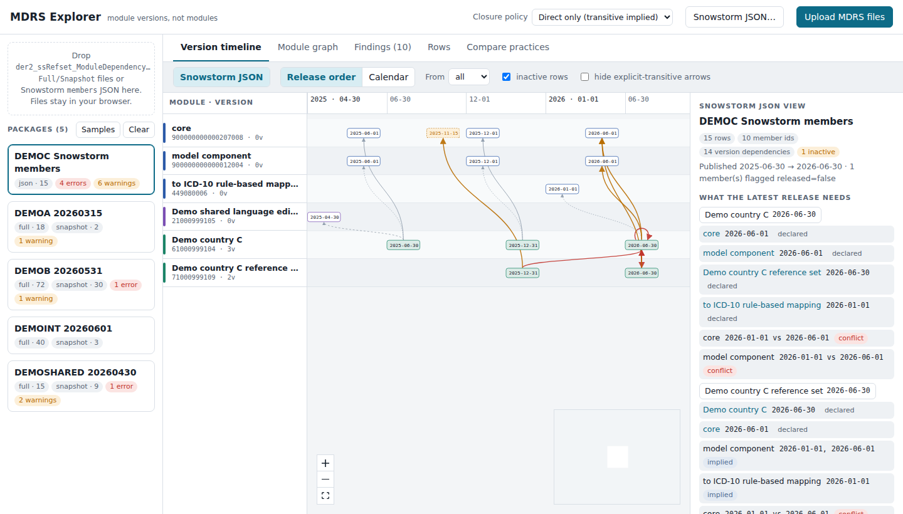

# MDRS Explorer

A browser tool for reading SNOMED CT **Module Dependency Reference Sets** (MDRS, refset `900000000000534007`) as what they describe: dependencies between **versioned modules**.

Each MDRS row says

```
moduleId @ sourceEffectiveTime  ──requires──▶  referencedComponentId @ targetEffectiveTime
```

The referenced component is a module *version*, not just a module. MDRS Explorer builds a version-level graph from the rows and draws it as a swimlane timeline: one lane per module, one box per module version, and arrows from each dependent version to the exact version it requires. It reads RF2 Full, Snapshot and Delta files and Snowstorm `members` JSON, and it runs the same validation over each of them. As a result, practices that look identical in a module-level diagram can be compared, for example reusing a member id per dependency versus creating a new member per version, or a latest-only versus a cumulative Snapshot.

Everything runs in the browser. Files you load never leave your machine.



## Installation

Requirements: Node.js 20.9 or later and npm.

```bash
git clone https://github.com/termMed/mdrs-viewer.git
cd mdrs-viewer
npm install
npm run dev              # http://localhost:3000
```

Production build:

```bash
npm run build
npm start                # http://localhost:3000
```

Static hosting (no Node server needed):

```bash
STATIC_EXPORT=1 npm run build     # static site in ./out
npm run build:standalone          # single page + app.js + samples in ./standalone
```

## Usage

### Load data

- **Upload MDRS files**: use the button or drop files anywhere on the page. Accepted names look like `der2_ssRefset_ModuleDependency(Full|Snapshot|Delta)…_<TAG>_<YYYYMMDD>.txt`. Files with the same tag and date are grouped as one package, so a release's Full and Snapshot appear together.
- **Snowstorm JSON**: paste the response of
  `…/<branch>/members?referenceSet=900000000000534007&limit=1000`.
  Leave `active` unset if you want inactivated members too, and set `limit` above the total. The dialog can also try to fetch the URL directly, but most public Snowstorm servers block requests from other sites or require a human check. In that case open the URL in a browser tab and paste the result.
- **Samples**: the synthetic demo packages in `public/samples` load on start (see [Demo data](#demo-data)).

Load the International release together with the extensions you study. Target versions and closures are resolved across everything loaded, which makes several checks stricter.

### Views

| Tab | What it shows |
|---|---|
| **Version timeline** | Lanes are ordered by dependency depth: model component at the top, dependents below. *Release order* spaces the release dates evenly; *Calendar* uses a true time axis. Click a version to highlight what it requires (blue) and what requires it (pink). The inspector lists declared dependencies, dependencies that are only implied, version conflicts, dependents and the underlying rows. |
| **Module graph** | Module-level summary laid out with ELK. Each arrow aggregates all version rows between two modules and shows the version count and the latest source → target pair. |
| **Findings** | Validation results for the current view. *Show on timeline* highlights the affected versions and rows. |
| **Rows** | The raw rows with their flags. The list can be filtered and sorted, and clicking a row selects its source version. |
| **Compare practices** | One column per loaded package: member id strategy, Snapshot content, redistributed upstream rows, closure style, whether the chain can be verified inside the file, and defect counts. |

View selector (per package):

- **Full**: every row ever published. *Rows published up to* shows the Full as it stood at an earlier release.
- **Snapshot**: the Snapshot file as distributed.
- **Snapshot as of…**: a Snapshot derived from the Full for any past release, to compare with what was actually shipped.
- **Snowstorm JSON**: members as returned by the terminology server, including the `released` flag.

The **closure policy** selector in the top bar switches between *direct only* (transitive dependencies may be implied) and *explicit closure required*. Use it to see what each convention would flag.

### Checks

| Code | Severity | Meaning |
|---|---|---|
| `SELF-DEP` | error | A module version depends on itself |
| `CYCLE` | error | Two or more modules depend on each other (strongly connected component) |
| `TARGET-AFTER-SOURCE` | error | targetEffectiveTime later than sourceEffectiveTime |
| `AMBIGUOUS-TARGET` | error | One source version requires two versions of the same module |
| `VERSION-CONFLICT` | error | The closure of a source version reaches two versions of the same module (e.g. core declared at one date and reached at another through a base edition or a map module) |
| `PHANTOM-TARGET` | warning | targetEffectiveTime is not described as a released version by any loaded MDRS |
| `ET-MISMATCH` | warning | effectiveTime ≠ sourceEffectiveTime on an active row |
| `RETRACTED` | warning | A historical version dependency was later inactivated |
| `DUPLICATE` | warning | The same version dependency is asserted by several member ids |
| `NOT-SELF-CONTAINED` | warning | The chain of the latest release cannot be followed inside the file because upstream rows are not included |
| `UNRELEASED` | warning | Snowstorm member with `released=false` |
| `ID-REUSE` · `ID-PER-VERSION` · `ID-MIXED` | info / warning | Member id strategy per source module |
| `SNAP-LATEST` · `SNAP-CUMULATIVE` | info | Whether the Snapshot keeps only the latest version or the history |
| `IMPLICIT` | info (warning under *explicit closure*) | A dependency is only implied transitively |
| `REDUNDANT` | info (under *direct only*) | A declared dependency is also reachable transitively |
| `UPSTREAM-INCLUDED` | info | The file redistributes MDRS rows of upstream modules |

### Command line

The same analysis can be run without the UI and prints JSON:

```bash
npm run analyse -- path/to/folder              # default policy: direct-only
npm run analyse -- path/to/folder explicit-closure
```

## Demo data

`public/samples` contains **synthetic** packages generated by `scripts/make_demo_samples.py`. Their modules use the fictitious namespace 1000999; only the International module identifiers (core, model component, ICD-10 map) are real. They reproduce the practices and problems found in real editions:

| Package | Illustrates |
|---|---|
| `DEMOINT` | International-style release: monthly core, reused member ids; the ICD-10 map module is released only twice a year |
| `DEMOSHARED` | A shared language edition: a new member per version until 2024-10, reused ids afterwards (hybrid Snapshot). Its dependency on the twice-yearly map module pulls in older core versions, so its closure becomes inconsistent |
| `DEMOA` | An extension with reused ids, a latest-only Snapshot and an explicit closure; it does not include upstream rows |
| `DEMOB` | An extension on the shared edition: a new member per version, upstream rows included, a sub-module that leaves core and model implied, and one release that declares a core version different from the one its base requires |
| `DEMOC` (Snowstorm JSON) | A self-dependency, a two-module cycle, a forward-dated target, a target date that is not a release, an inactivated historical dependency and an unreleased member |

To regenerate them, run `python3 scripts/make_demo_samples.py`. To use your own release files, upload them in the UI, or place them in `public/samples` and list them in `public/samples/manifest.json`.

## How it works

```
src/lib/mdrs/types.ts     data model: rows, version nodes and edges, findings
src/lib/mdrs/parse.ts     RF2 and Snowstorm JSON parsing, grouping files into packages
src/lib/mdrs/graph.ts     version graph, snapshot derivation, strongly connected components, closure
src/lib/mdrs/analysis.ts  checks and the practice profile used by Compare practices
src/lib/mdrs/layout.ts    swimlane layout (release order and calendar scales)
src/lib/mdrs/names.ts     module names, namespace and tier (International, derivative, shared edition, national)
src/components/           Explorer shell, Timeline (React Flow), ModuleGraph (React Flow + ELK)
scripts/                  CLI analysis, standalone build, demo data generator
```

- One **version node** per (module, effectiveTime) seen as a source or target.
- One **version edge** per (moduleId, sourceEffectiveTime, referencedComponentId, targetEffectiveTime). Its status comes from the latest row asserting it, so an inactivated historical row shows as a retracted edge.
- A target version is **phantom** when its module is described somewhere in the workspace but no row has that version as a source. Model component versions are taken from core versions.
- Closure is computed from the current view. When the view has no rows for a target version, rows from the other loaded packages are used.

Stack: Next.js 16, React 19, [@xyflow/react](https://reactflow.dev), [elkjs](https://github.com/kieler/elkjs). There is no server-side code.

## Contributing

Issues and pull requests are welcome, especially new checks and real-world MDRS patterns (please anonymise or synthesise the data).
